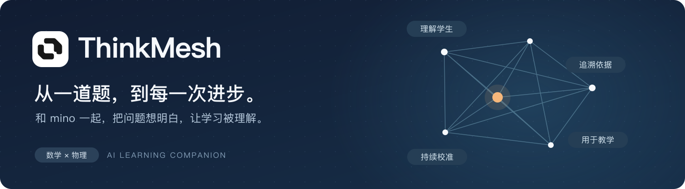
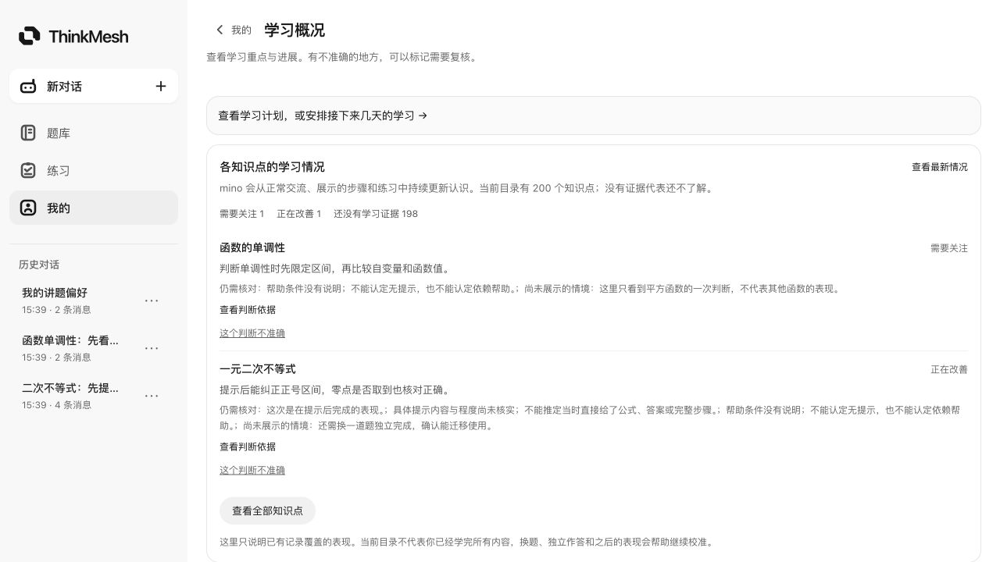

# ThinkMesh · 从一道题，到每一次进步。

面向高中数学与物理的 AI 学习伙伴。自然交流、读题讲题、练习复盘，持续校准对学生和知识点学习情况的认识。

[查看产品展示](https://zhangyuyao-zx.github.io/thinkmesh-showcase/) · [体验说明与当前入口](https://zhangyuyao-zx.github.io/thinkmesh-showcase/experience.html)

## 在学习中持续了解

- 从当前题目、已有步骤和真正卡住的环节开始辅导。
- 用公式、函数图、几何与物理示意辅助理解。
- 从已有教材与真题中选择练习，支持提交、批改、复盘与继续。
- 日常交流和实际作答形成可追溯证据，持续修订相关知识点的认识。
- 学情区分需要关注、正在改善、基本稳定与证据不足，保留覆盖范围和判断依据。
- 了解个人背景与讲题偏好，具体记录可以纠正或撤回。

## 展示素材说明

截图来自真实应用界面。学生对话、记录和学情为固定演示数据；资源页来自实际已发布的公共目录。知识点目录数量不代表学生掌握情况，部分题目参考答案仍待核验。

本仓库仅包含产品介绍与静态展示页面。ThinkMesh 应用源代码保留在私有仓库，不在此发布。

体验采用邀请码注册。临时入口可能变化或暂停，请以展示页上的当前入口为准。
